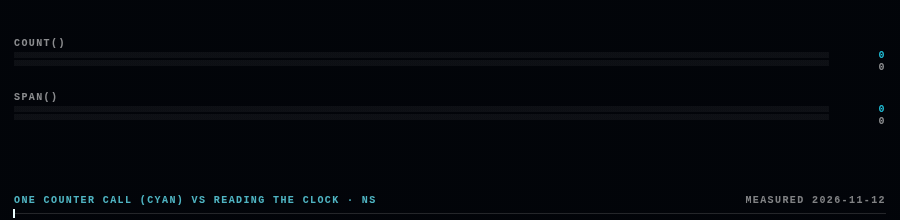

<div align="center">

# unum-usage

**Know which of your tool's commands are really used, and which fail, without sending anything anywhere.**

[](https://github.com/corpunum/unum-usage/actions/workflows/ci.yml) [](LICENSE)



</div>

## The idea in 30 seconds

You ship a CLI or a small daemon. A month later you want to know which commands people and agents actually run, which ones fail, and how long they take. The usual answer is a telemetry service, an async runtime and a privacy question.

unum-usage is the small answer. One call records that something happened: which tool, what kind of thing, its fixed name, whether it worked and how long it took. It appends one JSON line to a file in your own home directory. It never records arguments, content or personal data, and it has no network code at all.

It is built to be forgotten about: it never panics, never blocks its host, and swallows its own I/O errors, so a full disk or a read-only home cannot take your tool down.

## In code

Tiny, local-only usage counters for the Unum engines. Std plus `serde_json`; no async runtime, no network.

```rust
usage::count("myengine", "cmd", "status", true, 12);   // engine, kind, name, ok, ms
let mut t = usage::span("myengine", "route", "GET /api/items");
if bad { t.fail(); }                                  // ok=false; ms and ok recorded on drop
```

Kinds: `cmd`, `route`, `mcp`, `fn` (anything else is stored as `fn`).
For CLIs: `usage::cmd_start(engine, name)` at dispatch and `usage::cmd_exit(code)` / `usage::cmd_end(ok)` at the end (records and flushes). Long-lived servers need nothing extra; short-lived processes should call `usage::flush()` before exit.

## Output

Appends JSON lines to `~/.local/share/unum-usage/<engine>.jsonl`:

```json
{"ts":"2026-11-06T12:34:56.789Z","engine":"myengine","kind":"cmd","name":"status","ok":true,"ms":412}
```

`ts` is RFC 3339 UTC with milliseconds. Counts only: the caller passes a fixed name (a subcommand, a route pattern such as `GET /api/items/{id}`, a tool name); never arguments, content or personal data. Names are truncated to 96 characters.

- Buffered in memory, flushed in batches (8 KB, 1 s, or `flush()`), under a non-blocking file lock (`<engine>.lock`), O_APPEND writes.
- Rolls over at 20 MB to `<engine>.jsonl.1` (one generation kept).
- Never panics; all I/O errors are swallowed; the in-memory buffer is bounded (256 KB per engine).
- Env: `UNUM_USAGE=off` disables; `UNUM_USAGE_DIR` overrides the directory.

Needs Rust 1.89+ (std file locking). Micro-bench: `cargo run --release --example bench`.

## Try it in one minute

```toml
# Cargo.toml (not on crates.io yet: pin a git revision)
[dependencies]
unum-usage = { git = "https://github.com/corpunum/unum-usage", rev = "8e521e179066a5f3ae9b7ae3a33ecb1797a9c962" }
```

## Measured

| Metric | Result | Baseline | Sample | Method | Date |
|---|---|---|---|---|---|
| count() | 476 ns per call | 19 ns to read the clock (Instant::now) | 200,000 calls in one thread, median of 3 runs (468 to 478 ns), release build, machine not idle | cargo run --release --example bench | 2026-11-12 |
| span() | 561 ns per call | 19 ns to read the clock (Instant::now) | 200,000 calls in one thread, median of 3 runs (556 to 576 ns), release build, machine not idle | cargo run --release --example bench | 2026-11-12 |

## How it fits OpenUnum

OpenUnum is a local-first agent framework, and its Rust engines (search, scheduling, shipping, the decision inbox) count their commands, routes and MCP calls with this crate. OpenUnum reads those files to see which tools its agents really use and which ones fail. Nothing leaves the machine.

## Learn more

- [Source of the whole crate (one file)](src/lib.rs)
- [The micro-bench](examples/bench.rs)
- [Handover and open work](HANDOVER.md)
- [corpunum.com](https://corpunum.com)
- License: Apache-2.0
